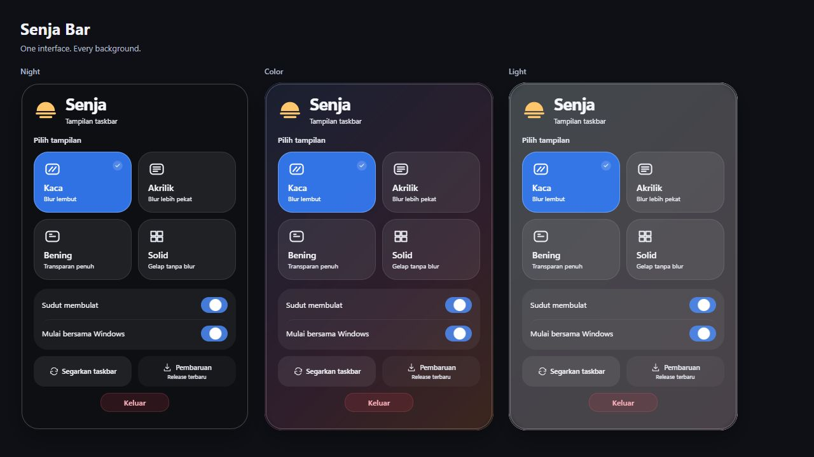
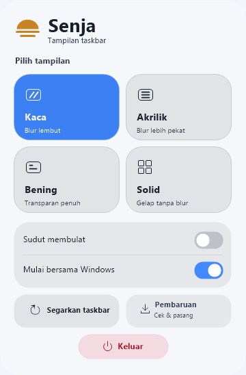

# Senja Bar

Empat tampilan taskbar Windows, dengan pengaturan dari system tray.

Four Windows taskbar styles, controlled from the system tray.

**[Unduh / Download Senja-Bar.exe](https://github.com/FyarrAja/Senja-Bar/releases/latest/download/Senja-Bar.exe)**

[Release](https://github.com/FyarrAja/Senja-Bar/releases/latest) · [Changelog](CHANGELOG.md) · [Build from source](docs/BUILD.md) · [English](#english)

  
  

*Menu native pada latar uji polos, ditangkap dari aplikasi v1.1.5. Gambar ini memperlihatkan panel pengaturan; efek taskbar tidak ditampilkan.*

## Tampilan & fitur

| Mode | Tampilan taskbar |
| --- | --- |
| **Kaca** | Blur dengan tint yang menyesuaikan tema dan nuansa latar. |
| **Akrilik** | Material akrilik dengan tint lebih pekat. |
| **Bening** | Transparan penuh. |
| **Solid** | Warna opak yang mengikuti tema Windows dan nuansa latar. |

Adaptasi warna memakai sampel di sekitar taskbar pada tiap monitor. Hasilnya dapat berbeda menurut latar dan versi Windows.

- Pilihan sudut taskbar membulat dan mulai bersama Windows.
- Animasi pemilihan mode, toggle, klik tombol, serta buka–tutup panel.
- Segarkan taskbar dan pasang pembaruan dari aplikasi.
- Mengganti mode tidak menutup panel. Klik di luar atau tutup tray untuk menutupnya.
- **Keluar** menghentikan Senja dan mengembalikan tampilan taskbar Windows.

## Mulai pakai

1. Unduh **Senja-Bar.exe** dari tautan di atas, lalu jalankan.
2. File pendamping disiapkan di `%LOCALAPPDATA%\Senja\app` tanpa akses admin. Launcher keluar setelah Senja berjalan.
3. Klik kanan ikon Senja di system tray. Jika tersembunyi, buka panah ikon tray terlebih dahulu.

Pengaturan disimpan di `%LOCALAPPDATA%\Senja\settings.ini`. Paket ZIP portable juga tersedia di halaman release.

## Alur pembaruan

**Menekan Pembaruan berarti memulai pengecekan dan pemasangan otomatis jika ada versi lebih baru. Belum ada dialog konfirmasi tambahan.**

1. **Memeriksa…** — cek release stabil terbaru dari repository ini.
2. **Mengunduh…** — jika versinya lebih baru, unduh EXE dan cocokkan checksum SHA-256 dengan file checksum release.
3. **Memasang…** — siapkan file versi baru, tutup Senja lama beserta panelnya, lalu jalankan versi baru.
4. Setelah versi baru berhasil menyiapkan tray dan taskbar, folder instalasi lama yang terverifikasi dibersihkan. File yang masih dikunci Windows dicoba lagi pada startup berikutnya.
5. Pengaturan dan preferensi mulai bersama Windows dipertahankan. File EXE unduhan pribadi tidak dihapus. Tidak perlu membuka browser atau restart Windows. Buka kembali panel dari tray setelah selesai.

Jika versinya sama atau lebih lama, status menjadi **Sudah terbaru** tanpa pemasangan ulang. Jika pengecekan atau unduhan gagal, tampil pesan kesalahan; unduhan yang tidak terverifikasi tidak dijalankan. Kamu dapat mencoba lagi.

Pengecekan hanya berjalan saat tombol ditekan. Tidak ada pengecekan update berkala di latar belakang.

## Dukungan & batasan

| Bagian | Kondisi saat ini |
| --- | --- |
| Sistem | Windows x64; terutama diuji pada Windows 11. Windows 10 belum terverifikasi penuh. |
| Panel | Native, transparan, tanpa WebView2. Blur latar panel belum diterapkan. |
| Aksesibilitas | Navigasi keyboard tersedia; integrasi screen reader belum diterapkan. |
| Release | Belum ditandatangani secara digital. Checksum dipakai untuk memeriksa integritas unduhan. |
| Memori | Pemakaian bergantung pada Windows dan kondisi aplikasi; tidak ada jaminan total RAM 1–2 MB. |

Proses panel berakhir saat ditutup. Animasi berhenti saat selesai; updater hanya berjalan ketika diminta. Adaptasi taskbar mengikuti event Windows tanpa polling warna terus-menerus. Rincian ada di [arsitektur](docs/ARCHITECTURE.md).

## English

Read the English guide

### Features

Senja Bar provides four taskbar styles: **Glass**, **Acrylic**, **Clear**, and **Solid**. Glass and Acrylic adapt their tint to the Windows system theme and nearby background colors; Solid stays opaque and theme appropriate; Clear stays fully transparent. Background sampling is approximate and results vary with Windows and the backdrop.

Includes rounded taskbar corners, launch at startup, animated controls, refresh, and in-app updates. Changing styles keeps the panel open. Clicking outside or dismissing the tray closes it. **Keluar** exits Senja and restores the Windows taskbar.

The images above are captures of the native v1.1.5 menu on plain test backgrounds. They show the settings panel, not taskbar effects.

### Install

Download **Senja-Bar.exe** and run it. Companion files are prepared under `%LOCALAPPDATA%\Senja\app` without administrator access; the launcher then exits. Right-click Senja's tray icon to open settings. A portable ZIP is also available.

Settings are stored in `%LOCALAPPDATA%\Senja\settings.ini`.

### Update flow

**Clicking Pembaruan checks for updates and automatically installs a newer version if available. There is no additional confirmation dialog.**

1. **Memeriksa…** — check this repository's latest stable release.
2. **Mengunduh…** — download a newer EXE and verify it against the release's SHA-256 checksums.
3. **Memasang…** — prepare the new files, close the old Senja and its panel, and start the new version.
4. Once the new engine has initialized its tray and taskbar, verified older managed installs are cleaned up. Windows-locked files are retried on a later startup.
5. Settings, the enabled startup preference and personal downloaded EXEs are preserved. No browser or Windows restart is needed. Reopen the panel from the tray afterward.

Equal or older releases show **Sudah terbaru** and are not installed. Check/download failures show an error; unverified downloads are not executed. Updates run only when requested, without scheduled background checks.

### Requirements & limitations

- Windows x64, primarily tested on Windows 11; Windows 10 is not fully verified.
- The native panel needs no WebView2. Panel backdrop blur and screen-reader integration are not yet implemented; keyboard navigation is available.
- Releases are unsigned. Checksums verify download integrity.
- Memory use varies; total RAM usage of 1–2 MB is not guaranteed. Panel and updater processes exit when finished, and animations stop at rest.

## Open source

**GPL-3.0** · [License](LICENSE) · [Notices](NOTICE) · [Dependencies](docs/DEPENDENCIES.json)

Derived from [LowBar](https://github.com/chematic/LowBar), originally Apache-2.0. Includes unmodified [TranslucentTB 2026.2](https://github.com/TranslucentTB/TranslucentTB/releases/tag/2026.2) components; corresponding source accompanies each release. Independent of Xiaomi and Apple.
